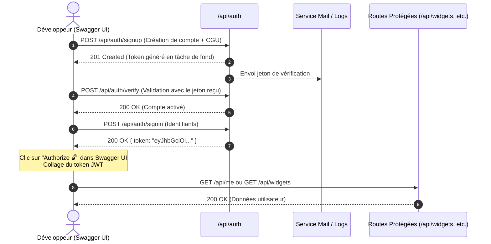

# Documentation Complète — Swagger & OpenAPI (API REST Dashboard)

Ce document constitue la référence technique et fonctionnelle officielle de la documentation de l'API REST du **Dashboard**, basée sur les spécifications **OpenAPI / Swagger** et visualisable de manière interactive avec **Swagger UI** et **ReDoc**.

---

## 1. Présentation de la Documentation Swagger / OpenAPI

FastAPI intègre nativement la génération du schéma OpenAPI à partir des routes, des types Python et des modèles **Pydantic**.
Toutes les routes, schémas de données, validations, en-têtes d'authentification et codes de statut HTTP de l'application sont exposés de manière unifiée et standardisée.

### 1.1. URLs d'accès

Lorsque le backend est démarré (`python main.py` ou via Docker) :

| Interface | URL | Description |
| :--- | :--- | :--- |
| **Swagger UI** | [http://localhost:3000/docs](http://localhost:3000/docs) | Interface interactive officielle permettant de tester les requêtes en direct avec bouton d'autorisation JWT. |
| **ReDoc** | [http://localhost:3000/redoc](http://localhost:3000/redoc) | Documentation alternative en vue trois colonnes, idéale pour la lecture technique approfondie. |
| **Spécification JSON** | [http://localhost:3000/openapi.json](http://localhost:3000/openapi.json) | Schéma JSON OpenAPI 3.1 brut généré dynamiquement par FastAPI. |

---

## 2. Guide d'utilisation interactive de Swagger UI

Swagger UI propose un bac à sable interactif (*Try it out*) connecté directement au serveur backend.

### 2.1. Flux complet pour tester une route protégée

La plupart des routes de l'API requièrent d'être authentifié via un jeton **JWT Bearer**. Suivez ces étapes pour tester l'API de bout en bout dans Swagger UI :



#### Étape 1 : Inscription (`POST /api/auth/signup`)
Dépliez la route `POST /api/auth/signup`, saisissez vos informations et assurez-vous que `acceptTerms` est à `true` :
```json
{
  "firstName": "Ada",
  "lastName": "Lovelace",
  "email": "ada.lovelace@example.com",
  "password": "Str0ng!Passw0rd",
  "acceptTerms": true
}
```
Cliquez sur **Execute**. En retour `201 Created`, un e-mail avec un jeton de 32 octets est émis.

#### Étape 2 : Confirmation de l'adresse e-mail (`POST /api/auth/verify`)
Récupérez le jeton de confirmation (reçu par mail ou visible dans les logs SMTP de test en local), puis dépliez `POST /api/auth/verify` :
```json
{
  "token": "votre_jeton_de_32_octets"
}
```
Cliquez sur **Execute** (Retour `200 OK`).

#### Étape 3 : Connexion et récupération du JWT (`POST /api/auth/signin`)
Dépliez `POST /api/auth/signin` :
```json
{
  "email": "ada.lovelace@example.com",
  "password": "Str0ng!Passw0rd"
}
```
Copiez la valeur de `token` renvoyée dans la réponse JSON.

#### Étape 4 : Autorisation globale dans Swagger UI
1. Remontez en haut de l'interface et cliquez sur le bouton vert **Authorize 🔓**.
2. Dans le champ de saisie, collez votre jeton JWT (la valeur pure ou précédée de `Bearer `).
3. Cliquez sur **Authorize**, puis sur **Close**.
4. Le cadenas est désormais verrouillé 🔒 : toutes vos requêtes suivantes sur Swagger UI incluront automatiquement l'en-tête HTTP :
   ```http
   Authorization: Bearer <votre_jeton_jwt>
   ```

---

## 3. Inventaire Exhaustif des Endpoints de l'API

L'API est organisée en 6 catégories fonctionnelles (**Tags**) :

### 3.1. Tag `auth` — Gestion des Comptes et Authentification

| Méthode | Route | Résumé | Auth Requise | Codes HTTP |
| :--- | :--- | :--- | :---: | :--- |
| `POST` | `/api/auth/signup` | Inscription d'un nouvel utilisateur | Non | `201`, `409`, `422` |
| `POST` | `/api/auth/signin` | Connexion et délivrance du jeton JWT | Non | `200`, `401`, `403`, `422` |
| `POST` | `/api/auth/verify` | Confirmation de l'e-mail via jeton | Non | `200`, `400`, `422` |

#### Détails des requêtes :
* **`POST /api/auth/signup`** :
  * **Body** : `SignUpRequest` (`firstName`, `lastName`, `email`, `password`, `acceptTerms`).
  * **Règles métier** : Mot de passe de 12 à 16 caractères comprenant au moins une majuscule, une minuscule, un chiffre et un caractère spécial. `acceptTerms` doit être un booléen strict `true`.
  * **Réponse 201** : `UserResponse` (`clientId`, `firstName`, `lastName`, `email`).

* **`POST /api/auth/signin`** :
  * **Body** : `SignInRequest` (`email`, `password`).
  * **Réponse 200** : `TokenResponse` (`token`).

* **`POST /api/auth/verify`** :
  * **Body** : `VerifyRequest` (`token`).
  * **Réponse 200** : `UserResponse`.

---

### 3.2. Tag `users` — Profil Utilisateur

| Méthode | Route | Résumé | Auth Requise | Codes HTTP |
| :--- | :--- | :--- | :---: | :--- |
| `GET` | `/api/me` | Récupération du profil connecté | **Oui** | `200`, `401` |
| `DELETE` | `/api/me` | Suppression définitive du compte | **Oui** | `204`, `400`, `401` |

#### Détails des requêtes :
* **`GET /api/me`** : Retourne les informations de l'utilisateur authentifié (`UserResponse`).
* **`DELETE /api/me`** : Supprime le compte, purge les widgets et révoque les accès OAuth Google et GitHub.
  * **Body obligatoire** : `{"confirmation": "DELETEMYACCOUNT-FORCE"}`.

---

### 3.3. Tag `widgets` — Orchestration et Exécution des Widgets

| Méthode | Route | Résumé | Auth Requise | Codes HTTP |
| :--- | :--- | :--- | :---: | :--- |
| `GET` | `/api/widgets` | Liste de tous les widgets configurés | **Oui** | `200`, `401` |
| `POST` | `/api/widgets` | Ajout et instanciation d'un nouveau widget | **Oui** | `201`, `401`, `404`, `422` |
| `PATCH` | `/api/widgets/positions` | Réorganisation spatiale globale de la grille | **Oui** | `204`, `400`, `401` |
| `PATCH` | `/api/widgets/{instance_id}` | Mise à jour (config, position, zoom, timer) | **Oui** | `200`, `401`, `404`, `410`, `422` |
| `DELETE` | `/api/widgets/{instance_id}` | Suppression d'un widget du tableau de bord | **Oui** | `204`, `401`, `404` |
| `GET` | `/api/widgets/{instance_id}/data` | Exécution et récupération des données en direct | **Oui** | `200`, `401`, `403`, `404`, `410`, `502` |

#### Exemples de configurations par widget (`config`) :
* **Weather (`weather` / `city_weather`)** : `{"city": "Paris"}`
* **Clock (`clock` / `world_clock`)** : `{"city": "Tokyo"}`
* **CheapShark (`cheapshark` / `deal_finder`)** : `{"title": "Portal", "limit": 5}`
* **RSS (`rss` / `feed_reader`)** : `{"url": "https://korben.info/feed", "limit": 5}`
* **GitHub (`github` / `repo_activity`)** : `{"repo": "torvalds/linux", "count": 5}`

---

### 3.4. Tag `oauth` — Intégrations OAuth2 Externes

| Méthode | Route | Résumé | Auth Requise | Codes HTTP |
| :--- | :--- | :--- | :---: | :--- |
| `GET` | `/api/oauth/google/url` | Génération de l'URL de consentement Google | **Oui** | `200`, `400`, `401`, `404` |
| `GET` | `/api/oauth/google/callback` | Point de rappel public Google | Non | `307` |
| `DELETE` | `/api/oauth/google` | Déconnexion du compte Google pour un widget | **Oui** | `204`, `401`, `404` |
| `GET` | `/api/oauth/github/url` | Génération de l'URL d'autorisation GitHub | **Oui** | `200`, `400`, `401`, `404`, `503` |
| `GET` | `/api/oauth/github/callback` | Point de rappel public GitHub | Non | `307` |
| `DELETE` | `/api/oauth/github` | Déconnexion du compte GitHub pour un widget | **Oui** | `204`, `401`, `404` |

---

### 3.5. Tag `translate` — Traduction Instantanée

| Méthode | Route | Résumé | Auth Requise | Codes HTTP |
| :--- | :--- | :--- | :---: | :--- |
| `POST` | `/api/translate` | Traduction d'un texte via LibreTranslate | **Oui** | `200`, `401`, `422`, `502` |

* **Body** :
  ```json
  {
    "text": "Hello world, this is a dashboard widget.",
    "source": "en",
    "target": "fr"
  }
  ```
* **Réponse 200** :
  ```json
  {
    "translatedText": "Bonjour le monde, ceci est un widget de tableau de bord."
  }
  ```

---

### 3.6. Tag `about` — Spécification d'état et catalogue Epitech

| Méthode | Route | Résumé | Auth Requise | Codes HTTP |
| :--- | :--- | :--- | :---: | :--- |
| `GET` | `/about.json` | État serveur, IP client et catalogue des services | Non | `200` |

* **Conformité** : Implémente strictement le sujet officiel Epitech Dashboard :
  ```json
  {
    "client": {
      "host": "127.0.0.1"
    },
    "server": {
      "current_time": 1728678000,
      "services": [
        {
          "name": "weather",
          "widgets": [
            {
              "name": "city_weather",
              "description": "Météo actuelle d'une ville",
              "params": [
                {
                  "name": "city",
                  "type": "string"
                }
              ]
            }
          ]
        }
      ]
    }
  }
  ```

---

## 4. Schémas de Données Pydantic (`schemas.py`)

Les schémas sont définis avec Pydantic v2 et convertissent automatiquement les champs en notation `camelCase` pour le frontend et les clients JSON externes :

| Schéma Pydantic | Usage | Champs Principaux |
| :--- | :--- | :--- |
| `SignUpRequest` | Inscription | `firstName`, `lastName`, `email`, `password`, `acceptTerms` |
| `SignInRequest` | Connexion | `email`, `password` |
| `TokenResponse` | Retour JWT | `token` (format JWT HS256) |
| `UserResponse` | Profil | `clientId` (UUIDv4), `firstName`, `lastName`, `email` |
| `VerifyRequest` | Vérification mail | `token` (32 caractères) |
| `DeleteAccountRequest` | Suppression compte | `confirmation` ("DELETEMYACCOUNT-FORCE") |
| `WidgetCreate` | Création widget | `serviceName`, `widgetName`, `config`, `refreshSeconds`, `x`, `y`, `scale` |
| `WidgetUpdate` | Modification widget | `config`, `refreshSeconds`, `x`, `y`, `scale` |
| `WidgetReorder` | Réordonnancement | `ids` (tableau d'entiers) |
| `WidgetResponse` | Données en base | `id`, `serviceName`, `widgetName`, `config`, `refreshSeconds`, `position`, `x`, `y`, `scale` |
| `TranslateRequest` | Demande de traduction | `text` (max 500 chars), `source`, `target` |

---

## 5. Codes de Statut HTTP et Gestion des Erreurs

Toutes les erreurs renvoyées par l'API sont standardisées au format JSON :
```json
{
  "detail": "Description compréhensible du problème rencontré"
}
```

| Code HTTP | Libellé | Circonstances d'apparition |
| :---: | :--- | :--- |
| `200` | OK | Requête traitée avec succès. |
| `201` | Created | Ressource créée (compte utilisateur, nouveau widget). |
| `204` | No Content | Action effectuée sans contenu en retour (suppression, réorganisation). |
| `307` | Temporary Redirect | Redirection navigateur lors des retours de callbacks OAuth2. |
| `400` | Bad Request | Paramètres incohérents, lien expiré ou confirmation de suppression erronée. |
| `401` | Unauthorized | Jeton JWT manquant, signature invalide ou session expirée. |
| `403` | Forbidden | Adresse e-mail non confirmée ou widget nécessitant une liaison OAuth préalable. |
| `404` | Not Found | Widget, utilisateur ou route inexistant. |
| `409` | Conflict | Adresse e-mail déjà enregistrée en base lors de l'inscription. |
| `410` | Gone | Widget obsolète ou retiré du catalogue. |
| `422` | Unprocessable Content | Échec de validation Pydantic (mot de passe faible, JSON mal formé, limites hors bornes). |
| `502` | Bad Gateway | Échec de communication avec un service distant tiers (Open-Meteo, CheapShark, LibreTranslate...). |
| `503` | Service Unavailable | Intégration non configurée côté serveur (ex: identifiants client GitHub manquants). |

---

## 6. Exemples d'appels cURL, Python & JavaScript

### 6.1. Exemple cURL — Récupération des données d'un widget

```bash
curl -X GET "http://localhost:3000/api/widgets/1/data" \
  -H "Accept: application/json" \
  -H "Authorization: Bearer VOTRE_TOKEN_JWT"
```

### 6.2. Exemple Python (httpx) — Création d'un widget météo

```python
import httpx

API_URL = "http://localhost:3000"
TOKEN = "VOTRE_TOKEN_JWT"

headers = {
    "Authorization": f"Bearer {TOKEN}",
    "Content-Type": "application/json"
}

payload = {
    "serviceName": "weather",
    "widgetName": "city_weather",
    "config": {"city": "Paris"},
    "refreshSeconds": 120.0,
    "scale": 1.0
}

response = httpx.post(f"{API_URL}/api/widgets", json=payload, headers=headers)
print("Statut:", response.status_code)
print("Widget créé:", response.json())
```

### 6.3. Exemple JavaScript (Fetch API) — Traduction de texte

```javascript
const response = await fetch("http://localhost:3000/api/translate", {
  method: "POST",
  headers: {
    "Content-Type": "application/json",
    "Authorization": `Bearer ${token}`
  },
  body: JSON.stringify({
    text: "Hello world",
    source: "en",
    target: "fr"
  })
});

const data = await response.json();
console.log("Traduction :", data.translatedText);
```
