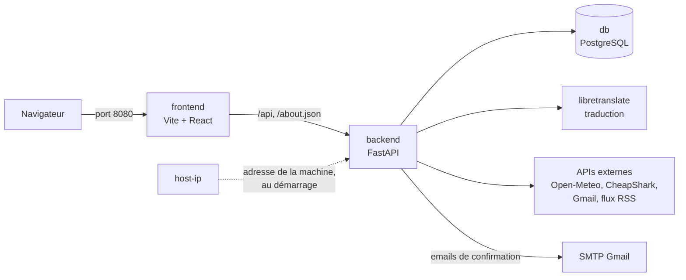

# Documentation — Architecture

Ce document explique comment le dashboard est construit. La partie 1 montre les briques et la façon dont elles communiquent, la partie 2 les grands principes, la partie 3 le rôle de chaque fichier du dépôt.

---

## 1. Vue d'ensemble

L'application tourne dans **cinq conteneurs Docker**, décrits dans [`docker-compose.yml`](../docker-compose.yml) :

| Conteneur | Technologie | Ouvert sur la machine ? | Rôle |
|---|---|---|---|
| `frontend` | Node.js, Vite, React, TypeScript | **Oui, port 8080** | Sert le site et relaie `/api` et `/about.json` vers le backend |
| `backend` | Python, FastAPI, SQLAlchemy | Non (port 3000 interne) | API : comptes, widgets, données des services, `about.json` |
| `db` | PostgreSQL 18 | Non | Stocke les comptes, les widgets et les connexions Gmail |
| `libretranslate` | LibreTranslate | Non (port 5000 interne) | Traduit les textes du widget Translate, sans service extérieur |
| `host-ip` | Alpine | Non | Relève l'adresse réseau de la machine au démarrage, puis s'arrête (§2.7) |

**Volumes Docker** (ce qui survit à l'arrêt des conteneurs) :
* `dashboard-db-data` : la base de données ;
* `dashboard-translate-models` : les modèles de traduction, ~2,6 Go ;
* `host-ip` : le fichier qui contient l'adresse de la machine.

---

## 2. Principes

### 2.1. Un seul point d'entrée : le port 8080

Le navigateur ne parle qu'au serveur Vite. Vite relaie tout ce qui commence par `/api`, ainsi que `/about.json`, vers le backend ([`frontend/vite.config.js`](../frontend/vite.config.js)). Cela apporte trois choses :
* **Pas de CORS** : le site et l'API ont la même origine (`localhost:8080`).
* **Le backend n'est pas joignable de l'extérieur** : il est seulement `expose` dans `docker-compose.yml`, pas publié.
* **L'adresse du visiteur est transmise** : Vite l'ajoute dans l'en-tête `X-Forwarded-For` (`xfwd`), que lit `about.json` (§2.7).

Le code des deux dossiers est monté dans les conteneurs : une modification est prise en compte tout de suite (`uvicorn --reload` côté backend, rechargement à chaud de Vite côté frontend).

---

### 2.2. Le catalogue des services

Tous les services sont décrits à un seul endroit : le dossier [`backend/catalog/`](../backend/catalog/). Chaque fichier déclare un `Service` (nom, connexion requise ou non) et ses `Widget` (nom, description, paramètres, fonction `fetch`), avec les types de [`catalog/types.py`](../backend/catalog/types.py).

| Service | Widget | Source des données |
|---|---|---|
| `weather` | `city_temperature`, `city_forecast` | API Open-Meteo |
| `clock` | `current_time` | Heure du serveur, fuseau trouvé par le géocodage Open-Meteo |
| `rss` | `article_list` | N'importe quel flux RSS ou Atom |
| `gmail` | `inbox` | API Gmail, avec une connexion OAuth par widget |
| `translate` | `text` | Conteneur LibreTranslate du projet |
| `cheapshark` | `free_games` | API CheapShark |

Ce catalogue sert à trois choses :
* **`about.json`** le décrit tel quel (`serialize_catalog`) ;
* **à l'ajout et à la modification d'un widget**, sa configuration est vérifiée contre les paramètres déclarés (`validate_config`). Une valeur invalide est refusée avec une erreur `422` ;
* **à la lecture des données**, le runner retrouve le widget et appelle sa fonction `fetch(config, credentials)` ([`backend/runner.py`](../backend/runner.py)).

Pour ajouter un service, il faut : un fichier dans `backend/catalog/` (ajouté à la liste `CATALOG`), une carte dans `frontend/src/components/`, et une entrée dans [`frontend/src/widget-types.ts`](../frontend/src/widget-types.ts).

---

### 2.3. La vie d'un widget

1. **Ajout** : « + Add » ouvre une fenêtre de réglages, puis le frontend envoie `POST /api/widgets` avec le service, le widget, la configuration, le rafraîchissement et une place libre (`x`, `y`). Le backend vérifie la configuration et enregistre une ligne dans `widget_instances`.
2. **Affichage** : la carte appelle `GET /api/widgets/{id}/data`. Le backend lance le `fetch` du widget, qui interroge la source de données, et renvoie `{ data, account, fetchedAt }`.
3. **Rafraîchissement** : la carte rappelle la même route toutes les `refreshSeconds` secondes ([`use-auto-refresh.ts`](../frontend/src/use-auto-refresh.ts)). L'appel suivant n'est programmé qu'une fois la réponse reçue, pour que deux lectures ne se chevauchent jamais.
4. **Modification** : les réglages, le déplacement et l'agrandissement envoient `PATCH /api/widgets/{id}` (`config`, `refreshSeconds`, `x`, `y`, `scale`). Le changement s'affiche tout de suite et est annulé si le serveur le refuse.
5. **Suppression** : la croix envoie `DELETE /api/widgets/{id}`.

En lecture des données, les erreurs ont chacune leur code :
* `403` : widget Gmail pas encore connecté ;
* `410` : widget retiré du catalogue ;
* `502` : la source extérieure n'a pas répondu, par exemple `translate is unavailable`.

---

### 2.4. Comptes et authentification

1. **Inscription** (`POST /api/auth/signup`) : le mot de passe est haché avec bcrypt, l'acceptation des conditions d'utilisation est datée, et un email contenant un lien de confirmation est envoyé en arrière-plan ([`backend/mailer.py`](../backend/mailer.py)).
2. **Confirmation** (`POST /api/auth/verify`) : la page `/verify` envoie le jeton du lien. Le compte est confirmé.
3. **Connexion** (`POST /api/auth/signin`) : le backend renvoie un **JWT** signé avec `JWT_SECRET`. Ce jeton ne contient que l'identifiant public du compte (`client_id`) et une date d'expiration.
4. **Requêtes suivantes** : le frontend garde le jeton dans le `localStorage` du navigateur et l'envoie dans l'en-tête `Authorization: Bearer …`. Côté backend, toute route qui dépend de `current_user` ([`backend/security.py`](../backend/security.py)) refuse une requête sans jeton valide, avec une `401`.
5. **Suppression du compte** (`DELETE /api/me`) : il faut taper un texte de confirmation. Les connexions Google du compte sont révoquées, puis le compte est supprimé avec ses widgets et ses connexions.

---

### 2.5. Les services avec connexion : Gmail (OAuth 2.0)

Chaque widget Gmail a **sa propre connexion** : on peut afficher plusieurs adresses sur le même dashboard.

1. « Connect Gmail » demande à `GET /api/oauth/google/url?widget={id}` l'adresse de la page de consentement Google.
2. Après l'accord de l'utilisateur, Google renvoie le navigateur vers `GET /api/oauth/google/callback`. Cette route est publique, puisque Google n'envoie pas le JWT : c'est un `state` signé qui indique de quel compte et de quel widget il s'agit.
3. Les jetons Google sont enregistrés dans la table `subscriptions`, et le widget y est relié (`subscription_id`).
4. À chaque lecture, `fetch` reçoit ces jetons (`credentials`) et les renouvelle s'ils ont expiré.
5. « Disconnect » ou la suppression du widget libère la connexion. Si plus aucun widget ne l'utilise, elle est révoquée chez Google ([`backend/subscriptions.py`](../backend/subscriptions.py)).

---

### 2.6. La base de données

Trois tables, déclarées dans [`backend/models.py`](../backend/models.py) :

| Table | Contenu |
|---|---|
| `users` | Un compte : nom, email, mot de passe haché, `client_id` public, état de confirmation, date d'acceptation des conditions |
| `widget_instances` | Un widget posé sur un dashboard : service, widget, configuration (JSON), rafraîchissement, place (`x`, `y`), zoom (`scale`), ordre d'empilement (`position`), connexion éventuelle |
| `subscriptions` | Une connexion à un service extérieur : compte Google (`account`) et jetons OAuth (`credentials`) |

Au démarrage, le backend crée les tables manquantes. Il ajoute aussi, avec des `ALTER TABLE … IF NOT EXISTS`, les colonnes apparues depuis ([`backend/main.py`](../backend/main.py)) : une base déjà remplie continue de fonctionner sans être effacée.

---

### 2.7. `about.json` et l'adresse du client

`GET /about.json` renvoie :
* l'adresse du visiteur (`client.host`) ;
* l'heure du serveur (`server.current_time`) ;
* la liste des services et de leurs widgets (`server.services`).

**Problème** : derrière Docker, le backend ne voit jamais l'adresse de la machine. Une requête venue de `localhost:8080` arrive par la passerelle du réseau Docker (par exemple `172.19.0.1`). Aucun conteneur sur le réseau Docker ne peut lire l'adresse réelle de la machine.

**Solution** :
1. Au démarrage, le conteneur `host-ip` tourne sur le réseau **de la machine** (`network_mode: host`). Il y relève l'adresse de sortie (`ip route get 1.1.1.1`) et l'écrit dans un volume partagé avec le backend.
2. Le backend lit l'adresse du visiteur dans **la dernière** entrée de `X-Forwarded-For`, celle ajoutée par Vite. Les entrées précédentes peuvent être inventées par le client.
3. Si cette adresse est la passerelle Docker, la requête vient de la machine elle-même : le backend la remplace par l'adresse écrite par `host-ip`. Un autre appareil du réseau garde sa propre adresse.

**Limite** : sous macOS et Windows, Docker tourne dans une machine virtuelle. L'adresse relevée est alors celle de cette machine virtuelle.

---

### 2.8. Le frontend

* **Pages** ([`frontend/src/main.tsx`](../frontend/src/main.tsx)) :

| Adresse | Page |
|---|---|
| `/` | Accueil |
| `/signup` | Inscription |
| `/signupsuccess` | Compte créé |
| `/verify` | Confirmation du compte |
| `/signin` | Connexion |
| `/dashboard` | Le dashboard |

* **Le dashboard** : [`pages/dashboard.tsx`](../frontend/src/pages/dashboard.tsx) charge le compte et ses widgets. Il assemble ensuite les morceaux du dossier `frontend/src/dashboard/` : en-tête, bibliothèque de widgets, zone des cartes, fenêtres, placement, déplacement, agrandissement.
* **Les cartes** : une carte par type de widget, dans `frontend/src/components/`. Toutes sont inscrites dans [`widget-types.ts`](../frontend/src/widget-types.ts) et partagent :
  * le même cadre (`WidgetFrame`) ;
  * le même chargement des données (`useWidgetData`) ;
  * le même formulaire de réglages (`WidgetForm`).
* **Placement libre** : chaque carte garde sa place (`x`, `y`) et son zoom (`scale`, de 1 à 2) en base. Sur téléphone (moins de 768 px), les cartes sont empilées dans l'ordre de lecture.
* **Styles** : les couleurs et les formes sont dans [`styles.ts`](../frontend/src/styles.ts). La mise en page et ce qui change sur téléphone sont dans [`index.css`](../frontend/src/index.css), car un style en ligne ne peut pas être modifié par une media query.

---

## 3. Rôle de chaque fichier

### 3.1. Racine du dépôt

| Fichier | Rôle |
|---|---|
| [`README.md`](../README.md) | Point d'entrée de la documentation : présentation et liens vers chaque document |
| [`docker-compose.yml`](../docker-compose.yml) | Décrit les cinq conteneurs, leurs liens, leurs ports et leurs volumes |
| [`.env.example`](../.env.example) | Modèle du fichier `.env`, avec des valeurs d'exemple, à copier puis remplir |
| [`.gitignore`](../.gitignore) | Fichiers que Git ignore : `.env`, `node_modules`, environnements Python, builds |

---

### 3.2. Backend — `backend/`

| Fichier | Rôle |
|---|---|
| [`Dockerfile`](../backend/Dockerfile) | Construit l'image du backend : installe les dépendances Python, puis lance uvicorn sur le port 3000 |
| [`.dockerignore`](../backend/.dockerignore) | Fichiers que Docker ne copie pas dans l'image (caches Python, environnements virtuels) |
| [`requirements.txt`](../backend/requirements.txt) | Dépendances Python : FastAPI, uvicorn, SQLAlchemy, asyncpg, httpx, bcrypt, PyJWT, Pydantic, feedparser |
| [`main.py`](../backend/main.py) | Crée l'application FastAPI, branche les routes, et crée ou met à jour les tables au démarrage |
| [`config.py`](../backend/config.py) | Lit les variables d'environnement du `.env`, et arrête le démarrage s'il en manque une |
| [`database.py`](../backend/database.py) | Connexion asynchrone à PostgreSQL, et une session de base de données par requête |
| [`models.py`](../backend/models.py) | Les tables `users`, `widget_instances` et `subscriptions` (modèles SQLAlchemy) |
| [`schemas.py`](../backend/schemas.py) | Format et vérification des données reçues et renvoyées par l'API (modèles Pydantic) |
| [`security.py`](../backend/security.py) | Hachage des mots de passe, création et lecture des JWT, `state` signé de la connexion Google |
| [`mailer.py`](../backend/mailer.py) | Envoie l'email de confirmation de compte par SMTP |
| [`google_oauth.py`](../backend/google_oauth.py) | Échanges OAuth avec Google : adresse de consentement, jetons, renouvellement, adresse du compte, révocation |
| [`subscriptions.py`](../backend/subscriptions.py) | Libère, et révoque chez Google, une connexion qu'aucun widget n'utilise plus |
| [`runner.py`](../backend/runner.py) | Lance le `fetch` d'un widget avec sa configuration et sa connexion, et traduit les erreurs |

#### `backend/routes/` — les routes de l'API

| Fichier | Rôle |
|---|---|
| [`__init__.py`](../backend/routes/__init__.py) | Fait du dossier un paquet Python (fichier vide) |
| [`auth.py`](../backend/routes/auth.py) | Inscription, confirmation du compte et connexion (`/api/auth/…`) |
| [`users.py`](../backend/routes/users.py) | Lecture du compte connecté et suppression du compte (`/api/me`) |
| [`widgets.py`](../backend/routes/widgets.py) | Liste, ajout, modification, suppression des widgets, et lecture de leurs données (`/api/widgets/…`) |
| [`oauth.py`](../backend/routes/oauth.py) | Connexion et déconnexion d'un widget Gmail à un compte Google (`/api/oauth/google/…`) |
| [`translate.py`](../backend/routes/translate.py) | Traduit le texte tapé dans le widget Translate, réservé aux utilisateurs connectés (`/api/translate`) |
| [`about.py`](../backend/routes/about.py) | Génère `/about.json` : adresse du client, heure du serveur et catalogue des services |

#### `backend/catalog/` — les services et leurs widgets

| Fichier | Rôle |
|---|---|
| [`__init__.py`](../backend/catalog/__init__.py) | Liste des services (`CATALOG`), recherche d'un widget, description pour `about.json`, vérification d'une configuration |
| [`types.py`](../backend/catalog/types.py) | Les types `Param`, `Widget` et `Service` qui décrivent le catalogue |
| [`errors.py`](../backend/catalog/errors.py) | Les erreurs du catalogue : configuration invalide, widget retiré, connexion absente, source en panne |
| [`places.py`](../backend/catalog/places.py) | Recherche d'une ville (coordonnées, pays, fuseau horaire), partagée par la météo et l'horloge |
| [`weather.py`](../backend/catalog/weather.py) | Service `weather` : température actuelle et prévisions de plusieurs jours d'une ville |
| [`clock.py`](../backend/catalog/clock.py) | Service `clock` : heure, date et décalage horaire d'une ville |
| [`rss.py`](../backend/catalog/rss.py) | Service `rss` : derniers articles d'un flux RSS ou Atom |
| [`gmail.py`](../backend/catalog/gmail.py) | Service `gmail` : derniers emails de la boîte de réception d'un compte Google |
| [`translate.py`](../backend/catalog/translate.py) | Service `translate` : liste des langues et traduction par LibreTranslate |
| [`cheapshark.py`](../backend/catalog/cheapshark.py) | Service `cheapshark` : jeux vidéo gratuits en ce moment |

---

### 3.3. Frontend — `frontend/`

| Fichier | Rôle |
|---|---|
| [`Dockerfile`](../frontend/Dockerfile) | Construit l'image du frontend : installe les dépendances Node.js, puis lance le serveur Vite |
| [`.dockerignore`](../frontend/.dockerignore) | Fichiers que Docker ne copie pas dans l'image (`node_modules`, `dist`) |
| [`package.json`](../frontend/package.json) | Dépendances (React, React Router, Vite, TypeScript) et scripts npm |
| [`package-lock.json`](../frontend/package-lock.json) | Versions exactes des dépendances installées, pour que tout le monde ait les mêmes |
| [`vite.config.js`](../frontend/vite.config.js) | Configuration de Vite : port 8080, relais de `/api` et `/about.json` vers le backend |
| [`tsconfig.json`](../frontend/tsconfig.json) | Options du compilateur TypeScript (mode strict) |
| [`index.html`](../frontend/index.html) | Page HTML unique, dans laquelle React affiche l'application |

#### `frontend/src/` — fichiers communs

| Fichier | Rôle |
|---|---|
| [`main.tsx`](../frontend/src/main.tsx) | Point d'entrée : démarre React et associe chaque adresse à sa page |
| [`App.tsx`](../frontend/src/App.tsx) | Page d'accueil : boutons Sign Up et Sign In, lien vers les mentions légales |
| [`api.ts`](../frontend/src/api.ts) | Appels à l'API (jeton, JSON, messages d'erreur), gestion du jeton, type `WidgetInstance` |
| [`widget-types.ts`](../frontend/src/widget-types.ts) | Registre des types de widgets : nom affiché, valeurs par défaut, champs de la fenêtre d'ajout, carte React |
| [`use-widget-data.ts`](../frontend/src/use-widget-data.ts) | Hook qui charge les données d'un widget, gère les états (chargement, erreur, non connecté) et le rafraîchissement |
| [`use-auto-refresh.ts`](../frontend/src/use-auto-refresh.ts) | Hook qui relance une lecture toutes les `refreshSeconds` secondes |
| [`refresh.ts`](../frontend/src/refresh.ts) | Bornes et lecture de l'intervalle de rafraîchissement tapé par l'utilisateur |
| [`validation.ts`](../frontend/src/validation.ts) | Règles de validation de l'email et du mot de passe dans les formulaires |
| [`legal.ts`](../frontend/src/legal.ts) | Adresses des pages légales, hébergées sur GitHub Pages |
| [`weather-icon.ts`](../frontend/src/weather-icon.ts) | Associe chaque condition météo envoyée par le backend à son icône |
| [`styles.ts`](../frontend/src/styles.ts) | Styles en ligne de l'application : couleurs, bordures, typographie |
| [`index.css`](../frontend/src/index.css) | Mise en page, placement libre des cartes et adaptation au téléphone |
| [`vite-env.d.ts`](../frontend/src/vite-env.d.ts) | Types de Vite pour TypeScript, par exemple l'import des images |

#### `frontend/src/pages/` — les pages

| Fichier | Rôle |
|---|---|
| [`singup.tsx`](../frontend/src/pages/singup.tsx) | Formulaire d'inscription, avec la case d'acceptation des conditions d'utilisation |
| [`signupsuccess.tsx`](../frontend/src/pages/signupsuccess.tsx) | Page « Account created », qui invite à ouvrir l'email de confirmation |
| [`verify.tsx`](../frontend/src/pages/verify.tsx) | Confirme le compte avec le jeton du lien reçu par email |
| [`signin.tsx`](../frontend/src/pages/signin.tsx) | Formulaire de connexion, qui enregistre le jeton puis ouvre le dashboard |
| [`dashboard.tsx`](../frontend/src/pages/dashboard.tsx) | Page du dashboard : charge le compte et les widgets, puis assemble les morceaux de `src/dashboard/` |

#### `frontend/src/dashboard/` — les morceaux du dashboard

| Fichier | Rôle |
|---|---|
| [`dashboard-header.tsx`](../frontend/src/dashboard/dashboard-header.tsx) | En-tête : message de bienvenue, titre, mentions légales et déconnexion |
| [`widget-library.tsx`](../frontend/src/dashboard/widget-library.tsx) | Barre latérale : chaque type de widget avec son bouton « + Add », et la suppression du compte |
| [`widget-canvas.tsx`](../frontend/src/dashboard/widget-canvas.tsx) | Zone des cartes : chaque widget à sa place, avec sa poignée de déplacement et son coin d'agrandissement |
| [`add-widget-modal.tsx`](../frontend/src/dashboard/add-widget-modal.tsx) | Fenêtre d'ajout d'un widget : ses réglages, puis la création |
| [`delete-account-modal.tsx`](../frontend/src/dashboard/delete-account-modal.tsx) | Fenêtre de suppression du compte, avec le texte de confirmation à taper |
| [`use-layout.ts`](../frontend/src/dashboard/use-layout.ts) | Calcule la place et la taille de chaque carte, et trouve une place libre pour une nouvelle |
| [`use-move.ts`](../frontend/src/dashboard/use-move.ts) | Déplacement d'une carte à la souris, au doigt ou aux flèches du clavier |
| [`use-resize.ts`](../frontend/src/dashboard/use-resize.ts) | Agrandissement d'une carte à la souris ou au clavier |
| [`use-widget-actions.ts`](../frontend/src/dashboard/use-widget-actions.ts) | Ajouter, dupliquer, supprimer, modifier, déplacer et agrandir un widget, avec annulation si le serveur refuse |

#### `frontend/src/components/` — les cartes et composants partagés

| Fichier | Rôle |
|---|---|
| [`widget-frame.tsx`](../frontend/src/components/widget-frame.tsx) | Cadre commun à toutes les cartes : titre, poignée, boutons dupliquer et supprimer |
| [`widget-form.tsx`](../frontend/src/components/widget-form.tsx) | Formulaire commun des réglages d'un widget, utilisé par la fenêtre d'ajout et par le panneau Settings |
| [`settings-panel.tsx`](../frontend/src/components/settings-panel.tsx) | Panneau Settings d'une carte, qui enregistre les nouveaux réglages |
| [`modal.tsx`](../frontend/src/components/modal.tsx) | Fenêtre par-dessus la page, qui gère le focus du clavier |
| [`field.tsx`](../frontend/src/components/field.tsx) | Champ de formulaire avec son libellé et son message d'erreur |
| [`weather-widget.tsx`](../frontend/src/components/weather-widget.tsx) | Carte météo : température actuelle, humidité et vent d'une ville |
| [`forecast-widget.tsx`](../frontend/src/components/forecast-widget.tsx) | Carte des prévisions météo sur plusieurs jours |
| [`clock-widget.tsx`](../frontend/src/components/clock-widget.tsx) | Carte horloge : heure d'une ville, à la seconde |
| [`rss-widget.tsx`](../frontend/src/components/rss-widget.tsx) | Carte des derniers articles d'un flux RSS |
| [`gmail-widget.tsx`](../frontend/src/components/gmail-widget.tsx) | Carte Gmail : connexion au compte Google, réglages, bouton « Open Gmail » |
| [`gmail-inbox.tsx`](../frontend/src/components/gmail-inbox.tsx) | Liste des emails d'une carte Gmail, chaque ligne ouvrant l'email dans Gmail |
| [`translate-widget.tsx`](../frontend/src/components/translate-widget.tsx) | Carte de traduction : texte traduit pendant la frappe, choix des langues |
| [`free-games-widget.tsx`](../frontend/src/components/free-games-widget.tsx) | Carte des jeux gratuits du moment, d'après CheapShark |

#### `frontend/src/assets/weather/` — les icônes météo

| Fichier | Rôle |
|---|---|
| `clear.png`, `clouds.png`, `drizzle.png`, `mist.png`, `rain.png`, `snow.png` | Icône de chaque condition météo |
| `humidity.png`, `wind.png` | Petites icônes à côté de l'humidité et du vent |

---

### 3.4. Documentation — `docs/`

| Fichier | Rôle |
|---|---|
| `installation_and_configuration.md` | Installer le projet et remplir le `.env` |
| `launching.md` | Démarrer, utiliser et arrêter l'application |
| `architecture.md` | Ce document |
| `tech_choice.md` | Les choix technologiques et leurs raisons |
| `DOC_WEATHER.md` | Le service météo et ses deux widgets |
| `DOC_CLOCK.md` | Le service horloge |
| `DOC_RSS.md` | Le service RSS |
| `DOC_GMAIL.md` | Le service Gmail et sa connexion OAuth |
| `DOC_TRANSLATE.md` | Le service de traduction |
| `DOC_CHEAPSHARK.md` | Le service des jeux gratuits |

---

Retour à la [documentation principale](../README.md).
